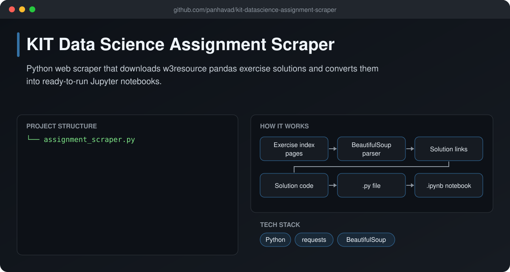
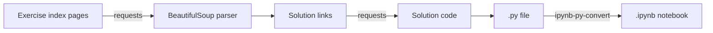

# KIT Data Science Assignment Scraper

  [](https://github.com/panhavad/kit-datascience-assignment-scraper/releases/latest)

A small **Python web scraper** that collects pandas exercise solutions from w3resource and converts each one into a `.py` file and a **Jupyter notebook**, so a whole exercise set is ready to study offline.



## Features

- Scrapes exercise index pages with BeautifulSoup
- Downloads every sample solution
- Saves `.py` files and converts them to `.ipynb`
- Edit `all_pages` to target other exercise sets

## How it works



## Getting started

```bash
pip install requests beautifulsoup4 ipynb-py-convert
python assignment_scraper.py
```

## Download

Grab the packaged source from the [latest release](https://github.com/panhavad/kit-datascience-assignment-scraper/releases/latest).

## Tech stack

- Python
- requests
- BeautifulSoup

## Project structure

```text
kit-datascience-assignment-scraper/
├── docs/
├── assignment_scraper.py
└── README.md
```
